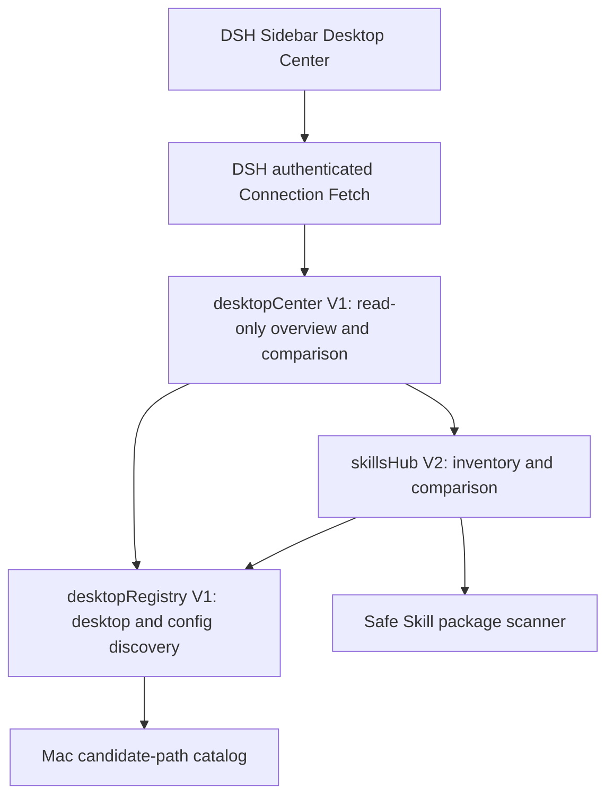

# DSH Desktop Center · 架构与产品边界 V0.3

**产品目标：** 在 DSH Desktop 中收集并展示用户本机 AI Desktop 的候选应用、已识别配置目录、Skills 清单、指纹差异与扫描诊断。

## 包含与不包含

**包含**：macOS Desktop 本地发现（Qoder Global / CN、WorkBuddy、Trae、Codex Desktop、ZCode、豆包）、只读 Skills 扫描、跨应用差异、DSH 侧边栏只读 UI、诊断、适配器证据状态。

**不包含**：SuperAgent 任务编排、应用会话控制、CLI 执行器、账号签到、积分、MCP 配置写入、插件安装、Skills 分发或同步。这些若启动应归入与本项目独立的插件，不在此仓库记录其未实现接口或向用户承诺功能。

## 实现组成

一个安装入口 `packages/desktop-center` 包含 Host、Client、Registry 与 Skills 模块快照。规范算法源码留在 `packages/desktop-registry/src` 和 `packages/skills-hub/src`，打包脚本会将它们复制至 Bundle；两个模块保留独立接口，当前 Bundle **作为一个整体启停**。

### Cordis 服务和路由

- `desktopRegistry` V1：`targets()`、`listDesktops()`。
- `skillsHub` V2：`inventory()`、`compare()`。
- `desktopCenter` V1：`overview()`、`comparison()`。
- DSH 认证只读 GET：`/api/dsh-desktop-center/health`、`/api/dsh-desktop-center/overview`、`/api/dsh-desktop-center/comparison`。
- 客户端 ID、侧边栏 ID 与主页面 ID 统一使用 `dsh-desktop-center`。

正式接口见 `contracts/index.d.ts`；真实 DSH 调用兼容性尚待 macOS 实机验证，不能凭本地模拟视为宿主兼容性已经证实。

## 只读扫描规则

- 仅扫描预定义候选 `.app` 目录与 Skills 目录。目录发现不代表软件正在运行、账户登录或外部服务连接成功。
- `SKILL.md` 限制读取大小，读取名字和描述；整个 Skill 包计算确定性哈希（包含 `scripts/`、`references/` 等普通文件）。
- 超大文件、符号链接越界、隐藏或不可检查内容明确返回 `unknown`；不执行第三方代码。
- `~/.agents/skills` 等共享根目录可在多个 Desktop 视图出现，不复制也不更改文件。
- 数据留在本机进程内存，不自动上传；错误响应不回显原始异常、敏感路径或凭据。

## 目标 Desktop

| Desktop | 用户级 Skills 候选 | 不确定性 |
|---|---|---|
| Qoder 国际版 | `~/.qoder/skills`、共享 `~/.agents/skills` | 需按实际 Desktop 版本验证 |
| Qoder CN | `~/.qoder-cn/skills`、共享 `~/.agents/skills` | 与国际版分开识别 |
| WorkBuddy | `~/.workbuddy/skills` | 独立用户目录 |
| Trae | `~/.trae/skills` | CN 版需独立核对 |
| Codex Desktop | `~/.agents/skills`、旧版 `~/.codex/skills` | 共享目录不代表已在应用 UI 启用 |

## 验收与版本

- 本地 Node 单测、语法和公共类型检查与 npm pack 属于**离线验证**。
- 正式宣布可用之前，需要在真实 macOS DSH 安装、启动、页面加载、刷新、卸载/HMR、目录权限拒绝等场景验证。
- 对外发布 `v0.3.0-rc.2` 仅标记预发布，不作为实机验证通过的凭据。
- 独立的后续功能不应混入本项目接口/Docs；若某信息项变成“修改或控制”，应先重新评审产品边界。

参见 [安装验证](INSTALLATION_V0.3.md)、[Design System](DESIGN_SYSTEM.md)、[完成定义](DEFINITION_OF_DONE.md)。
