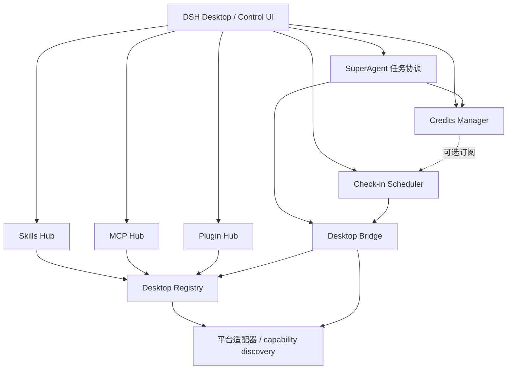

# DSH SuperAgent 插件体系架构设计 V1.2

**状态：** Host + Client 本地自动测试通过，Mac DSH 集成待验证；**第一批实现：** Registry + Skills Hub（只读）；**V0.3 新增：** 单安装包与 Desktop Center 侧边栏 Client 原型；**宿主：** DSH Desktop（Cordis）；**目标系统：** macOS。

## 1. 目标与非目标

### 目标
- 从 DSH 统一管理 Qoder 国际版、Qoder CN、WorkBuddy、Trae、Codex **Desktop**。
- 以独立服务/模块实现功能并维持低耦合。V0.3 为便利首次安装采用一个聚合 Bundle，能分别测试服务，但只能整体启停；后续允许单独发布 Bundle。
- Skills/MCP/Plugin/签到/积分/任务调度独立演进；按需通过稳定服务调用。
- **中央管理而非强制同步**：同一 Skill 可以适配多个 Desktop，但原生插件格式不等价。

### 非目标
- 把外部 Desktop 的 CLI 当作 Desktop 应用会话的控制接口。
- 模拟用户浏览器/桌面指纹，规避反自动化机制，绕过验证码/风控。
- 通过文件系统扫描冒充“账号已登录、正在运行、积分已到账”事实。
- 未授权访问凭据、自动合并代码或静默安装来自互联网的执行代码。

## 2. 模块关系



### 依赖原则
- `desktop-registry`：无业务插件依赖，只读应用与配置目录探测；将来可引入 adapter registry。
- `skills-hub`：仅依赖 `desktopRegistry` Cordis service；不保存签到/积分状态。
- `mcp-hub`：独立的 MCP 配置/状态，依赖 Registry 定位应用；凭据通过 DSH 官方凭据服务或 macOS Keychain 处理。
- `plugin-hub`：原生插件安装协议按平台处理；不能把 DSH Cordis 插件复制到其他 Desktop。
- `desktop-bridge`：仅在被允许的能力上交互，针对 Desktop 的现有会话，按应用认证/连接状态适配。
- `checkin-manager`：单独维护日程、签到状态和执行记录；可选调用 Bridge；独立于 Credits。
- `credits-manager`：独立记账，记录来源、到期批次、可用额度及证据质量；只能**推荐平台**，不能改变平台内部扣费 FIFO/FEFO 规则。
- `superagent`：通过能力查询和服务契约选择可用 Desktop，将任务投递、取消、收集结果；不能只因为“临期积分”而执行无意义操作。

**共享底座：** 优先复用 DSH 既有权限/设置/凭据/日志/事件系统。需要的公共类型放 `contracts/`；暂不引入“万能基础插件”。

## 3. 已实现公共 API（V0.3 更新）

```ts
interface DesktopRegistryServiceV1 {
  version: 1;
  targets(): { id: string; label: string }[];
  listDesktops(): Promise<DesktopRecord[]>;
}
interface SkillsHubServiceV2 {
  version: 2;
  inventory(): Promise<Inventory>;
  compare(): Promise<DiffMatrix>;
}
```

真实定义见 `contracts/index.d.ts`。Cordis service 名分别为 `desktopRegistry` 和 `skillsHub`。V0.2 的 `skillsHub` 服务版本升级为 2，消费者须处理 `unknown` 状态与 `packageSha256: null`。Skills Hub `inject = ['desktopRegistry']`；提供者卸载时消费者依赖自动失效，避免悬挂的服务引用。

V0.3 在一个聚合 Bundle 中提供 `desktopRegistry`、`skillsHub`、`desktopCenter` 三个服务，后者公开 `overview()` / `comparison()`；DSH Client 经认证 GET `/api/dsh-superagent/{health,overview,comparison}` 读取数据，不需要或允许跨应用写入。

**当前扫描行为：**
- macOS 只检查预定义的 `.app` 候选位置与 Skills 目录；未检测到应用时，配置存在只标记为 `configuration-found`。
- `SKILL.md` 最多读取 64 KiB；只提取前置元数据的 `name`、`description`，保留清单文件 SHA-256，并对整个 Skill 包（包括 `references` 与 `scripts`）求确定性哈希作比较；过大、隐藏或无法安全处理的内容返回 `unknown`，不执行任何代码。
- symlink 指向用户 home 之外默认跳过；不可读/无权限/文件过大标记诊断信息。
- 共享根目录如 `~/.agents/skills` 会出现在多个平台的视图中，但不会复制文件。
- 扫描结果仅保留内存，不持久存储或上传远程服务器。

## 4. 平台目录规则（Mac）

| Desktop | 首选用户级 Skills | 备注 |
|---|---|---|
| Qoder 国际版 | `~/.qoder/skills`，也支持 `~/.agents/skills` | Qoder 官方资料 |
| Qoder CN | `~/.qoder-cn/skills`，也支持 `~/.agents/skills` | CN 独立账户与目录，需实际验证版本 |
| WorkBuddy | **未确定** | 先识别应用存在，不套用 `.codebuddy` |
| Trae 国际版 | `~/.trae/skills` | 如果用户安装的是 Trae CN，需新增 CN Adapter |
| Codex Desktop | `~/.agents/skills`，兼容检查 `~/.codex/skills` | 官方以 `.agents` 为规范路径，legacy 单独标记 |

**同名目录不是同一产品的证据**。Qoder IDE、Qoder CLI、QoderWork 的规则可能存在差异。严格按实际 Desktop 类型、版本和用户启用的配置确定扫描优先级。目录存在不等于 Skill 已在应用 UI 中生效。

## 5. 未来模块的接口及事件

- Check-in：`status(desktopId)` / `run(desktopId)`，状态 `unavailable|due|completed|needs-attention|unknown`。
- Credits：`snapshot(desktopId)` / `expiring(days)`，必须保留 `provenance`（verified/estimated/unknown）和 `observedAt`；积分批次单独记录。
- Desktop Bridge：`capabilities(desktopId)` / `request(desktopId, capability, request)`，调用返回 receipt，不承诺自动具备现有会话控制权限。
- Skills Hub V2：`inventory()` 扫描全包指纹，`compare()` 使用三态 `same/different/unknown`；`planInstall()` 属于未来版本，现**未实现**。
- 推荐事件（尚未实现）：`desktop/changed`、`skills/diff-ready`、`checkin/completed`、`credits/expiring`、`task/status-changed`。

事件只传 ID、状态与必要的摘要，不带 API Key、Token、Cookie 或原始登录响应。

## 6. 签到与积分（后续设计）

每个平台建立独立 AccountScope（尤其 Qoder CN / Global），统一按服务方所在时区判断日期和奖励开放窗口。合规随机调度用于**分散资源消耗**，随机区间必须在平台明确允许的时间内；重启不改变当天计划时间，幂等键为 `accountScope + program + rewardDate`。验证码、认证失败、异常风控时停止自动操作，不再重试绕过。

积分设计拆成 Ledger（实际批次）与 Entitlement（配额/重置周期）。编码上不可把 Codex 的限额重置当成“每日签到积分”。到期展示优先真实来源；缺少明细则标记未知而不是计算一个看起来确定的日期。SuperAgent 只调整**平台选择优先级**，平台内部扣除哪批积分仍由平台负责。

## 7. UI 与用户操作

V0.1–V0.2 只有 Host services。**V0.3 已编写并通过离线注册测试的 Client** 按官方 `main` + `sidebar.panellist` Slot 注册 Desktop Center 页面，支持四个只读标签：桌面应用、Skills 清单、跨端差异与诊断；**但尚未在用户 macOS DSH Desktop 装载验证**。以下其余分区属于后续规划：
- 概览：5 个 Desktop 的“应用/配置已发现”与“未验证”，不制造在线状态。
- Skills：技能名称、来源、作用域、版本/哈希、冲突提示、部署预览。
- MCP：服务列表、状态、凭据引用、权限边界；默认不显示密钥。
- Plugins：应用原生扩展与 DSH Bundle 独立分组；兼容性矩阵。
- Rewards：账户作用域、签到结果、积分批次、过期倒计时与证据时间。
- Tasks：任务分配、审批、错误信息、执行日志与开发产物。

## 8. 操作完整性与数据安全

- **写入默认关闭**；部署需 dry-run Diff + 用户确认 + 原文件备份 + SHA-256 校验 + 同目录原子替换 + 失败回滚。
- 不自动执行新增的 MCP Server 命令；MCP Server 是可以执行代码的工具，启用须受权限审核。
- 每个 Desktop 适配器声明支持的能力和版本；未验证的能力返回 `unsupported`，不绕行未公开接口。
- 使用 DSH 服务/官方授权扩展，避免直接访问别的 Desktop 的内部数据库与 session token。
- 用户拥有停用、移除、回退插件的控制权。

## 9. 验收标准

### V0.1（已完成自动化测试）
- [x] 两个独立 Bundle，单一功能和 Cordis service 接口。
- [x] Mac 常见 Skills 目录配置映射与五个 Desktop 目标定义。
- [x] 工作区外软链接保护、文件大小限制、只读差异哈希。
- [x] Node 20+ 内置测试覆盖核心逻辑。
- [ ] 真实 DSH Desktop 安装及与官方 Host 的集成测试。
- [ ] macOS 五个真实应用的可见/权限路径交叉确认。
- [ ] DSH 侧边栏 UI / IPC / RPC。

### V0.2（工程治理与全包差异实现）
- [x] 研发工程标准、完成定义、Skills 边界与 UI Design System。
- [x] Skills Hub V2 全包指纹、异常状态 `unknown` 与对应测试。
- [x] 离线语法/单测/公共类型检查；增加在线 lint/format/CI 配置。
- [ ] 完整 lint/format/CI 在线运行和锁文件生成。

### V0.3（单包安装与 Client 原型）
- [x] `dsh-superagent-desktop-center` 一个 npm Bundle 包包含 `dsh.bundle` 与 `dsh.client` manifest。
- [x] 原生 Client 侧边栏与 `main` 面板注册（离线模拟测试）、四个只读标签、刷新/搜索/错误提示。
- [x] Host 认证 GET 路由、完整包依赖、源码到 `.tgz` 发布格式的打包测试。
- [x] 保留服务层独立契约，版本化边界与只读扫描规则。
- [ ] 真实 macOS DSH Desktop 安装、界面截图及卸载/HMR 验证。
- [ ] WorkBuddy 的用户级 Skills 目录经过真实客户端核实后接入。
- [ ] 线上 ESLint/Prettier CI 全部通过后再发布 GitHub/npm。

### V0.4（待开发）
- 经用户确认的 Skills 发布/同步与回滚，并实现 MCP Hub 的只读发现。

## 10. 外部依赖与许可

不复制第三方管理器源码，先重用公开的目录规则与抽象。若之后引入 `skill-buddy`、`skills-manager`、`mcp-manager` 的代码，须复核许可证、维护状态与 API，保持每个 Bundle 可替换。

## 11. 工程治理与视觉规范（V0.2）

- 开发/代码风格：`docs/DEVELOPMENT.md`、`AGENTS.md`。
- 完成状态及证据：`docs/DEFINITION_OF_DONE.md`；质量门禁：`docs/QUALITY_GATES.md`。
- Skills 触发与职责边界：`docs/SKILLS_POLICY.md`；视觉 Token、状态及评审：`docs/DESIGN_SYSTEM.md`。
- 花叔 Design 和 Unslop 是**可选的外部设计 Skills**，未安装；前者用于前期视觉方向，后者用于截图质量改进；宿主约束始终优先。
